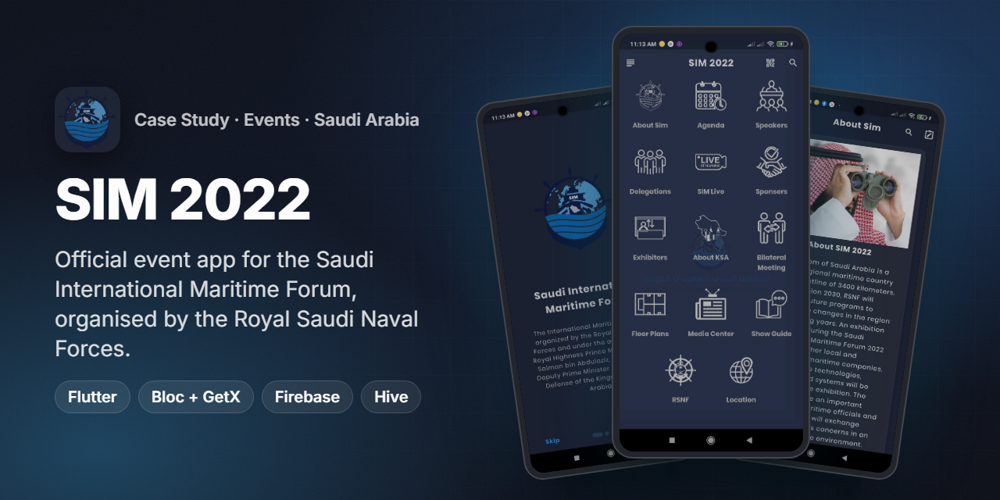
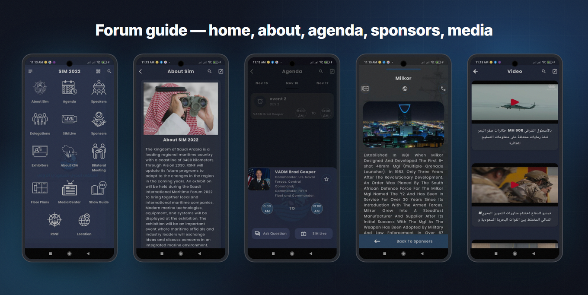
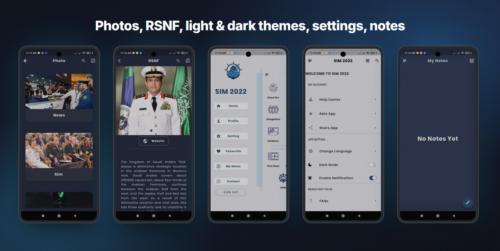
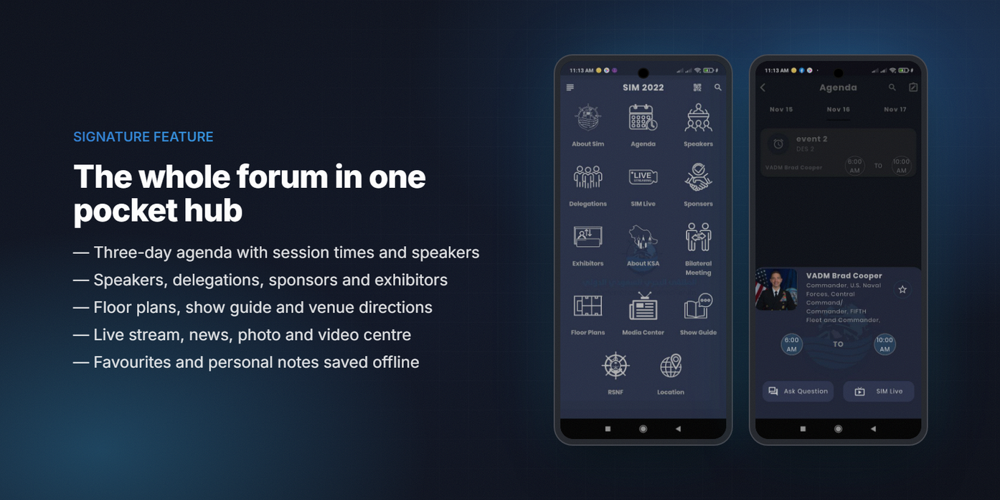
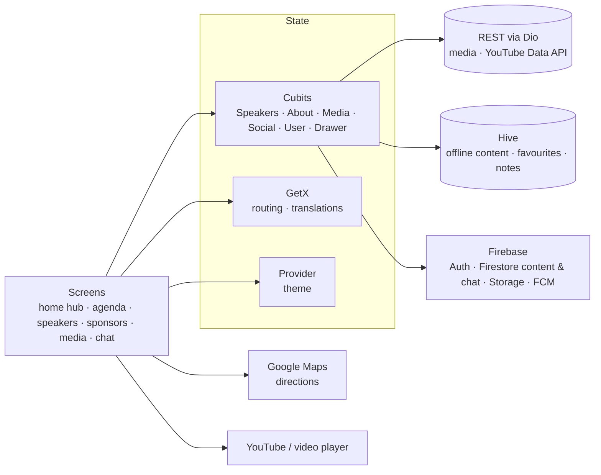

<h1 align="center">SIM 2022</h1>

<b>The official companion app for the Saudi International Maritime Forum 2022 — agenda, speakers, delegations, exhibitors, live stream and networking in one place.</b>

  
  
  
  
  
  
  

> ℹ️ Case study — the source code is proprietary to the client and is not included.

## Overview

The **Saudi International Maritime Forum (SIM)** is organised by the **Royal Saudi Naval Forces (RSNF)** and brings together naval delegations, maritime companies and industry leaders. For the 2022 edition I built the forum's official mobile app: a pocket guide for attendees, delegations and exhibitors before and during the three event days.

| | |
|---|---|
| **Client** | Event app for the Royal Saudi Naval Forces' maritime forum |
| **Users** | Attendees, official delegations, speakers, sponsors and exhibitors |
| **Platforms** | Android (Google Play) and iOS (App Store, "SIM 2022") — listings retired after the event |
| **My role** | Flutter developer — the full app, from architecture to store release |
| **Timeline** | Built August – October 2022, live for the forum (agenda: 15 – 17 November) |

## The challenge

- **A hard deadline.** An event app is useless one day late — it had to be on both stores before the forum opened.
- **A lot of content, changing until the last minute.** Agenda, speakers, delegations, sponsors, exhibitors, news and media were updated by the organisers right up to the event.
- **Venue connectivity.** Exhibition halls are crowded; content already seen, favourites and notes had to stay available offline.
- **International audience.** Arabic and English, readable in light and dark, with official protocol content (about the forum, the RSNF and the Kingdom).

## Highlights

**🗓️ Programme**
- Three-day agenda with session times, linked speakers, "Ask a question" and a jump to the live stream
- Speakers and delegations with photos, titles and biographies
- Bilateral-meeting section for delegations

**🏢 Exhibition**
- Sponsors and exhibitors with profile, website and contact
- Floor plans, show guide and venue location with in-app directions (Google Maps + route polyline)

**📺 Media**
- Live stream ("SIM Live"), news, photo galleries and video centre (YouTube player)
- About SIM, about the RSNF and about the Kingdom

**👤 Personal**
- Account sign-in and profile, personal **QR badge**
- One-to-one chat between attendees (Firestore)
- Favourites (speakers, delegations, sponsors, exhibitors, news) and personal notes — stored offline
- Search across speakers and sponsors, Arabic / English, light / dark mode, push notifications, help centre and FAQs

## Screens

Home hub, about SIM 2022, agenda, sponsor profile and video centre.

Photo galleries, RSNF page, navigation drawer in light theme, settings and personal notes.

## Signature feature — the whole forum in one pocket hub

**How it works**
1. The home screen is a single grid of 14 entry points (About SIM, Agenda, Speakers, Delegations, SIM Live, Sponsors, Exhibitors, About KSA, Bilateral Meeting, Floor Plans, Media Center, Show Guide, RSNF, Location), so any content is one tap away.
2. Speakers, delegations, sponsors, exhibitors, banners and photos live in **Cloud Firestore**, so the organisers could update content up to the last minute without a new release — and Firestore's on-device cache keeps already-loaded pages readable when the hall Wi-Fi drops.
3. Anything the attendee stars — speakers, delegations, sponsors, exhibitors, news — is saved in typed Hive boxes, together with personal notes, and shown in a tabbed Favourites screen.
4. From any session the attendee can ask a question or jump straight to the live stream.

## Architecture & stack

| Layer | Tech |
|---|---|
| UI | Flutter, `flutter_screenutil`, `flutter_zoom_drawer`, staggered grid & animations, shimmer, `clay_containers` |
| State | `flutter_bloc` (Cubits per feature) + GetX (`GetMaterialApp`, translations) + Provider (theme) |
| Content | Cloud Firestore (speakers, delegations, sponsors, exhibitors, banners, photos); Dio + YouTube Data API (media, playlists) |
| Offline | Hive with generated type adapters (notes, favourite speakers / sponsors / news) |
| Firebase | Auth, Cloud Firestore (content + chat), Storage, Messaging |
| Maps | `google_maps_flutter`, `geolocator`, `flutter_polyline_points` |
| Media | `youtube_player_flutter`, `video_player`, `webview_flutter`, image download / gallery save |
| Other | `qr_flutter` (personal badge), `flutter_typeahead` (search), `flutter_email_sender` (support), share & rate |

## Engineering notes

- **Content the organisers can change live.** Event data sits in Firestore collections, so late changes to speakers, sponsors or banners reached every phone without a store update; Firestore's local cache covers flaky venue connectivity, and Hive holds everything personal (favourites, notes).
- **Typed favourites.** Favourites use separate Hive boxes with generated adapters per type (speakers, delegations, sponsors, exhibitors, news), which kept the Favourites tabs simple and fast.
- **Directions to the venue.** The location screen draws the route on Google Maps by decoding the directions polyline, from the attendee's current position.
- **Attendee chat.** Messages are stored per user pair in Cloud Firestore (`Users → chats → messages`) and streamed live.
- **Two languages, two themes.** GetX translations for Arabic / English and a persisted dark-mode preference applied at start-up.
- **Built to a fixed date.** Feature-per-folder Cubits let screens be built and shipped in parallel; the app went from first commit to stores in about two months.

## Results

- Delivered and published on **Google Play and the App Store** ("SIM 2022") for the forum in **November 2022**.
- Covered **14 content areas** of the forum in a single app.
- The listings were retired after the event, as is common for single-edition event apps.

## بالعربي

**SIM 2022** هو التطبيق الرسمي للمنتدى البحري السعودي الدولي 2022 الذي نظّمته **القوات البحرية الملكية السعودية**.
يجمع التطبيق كل ما يحتاجه الزائر: جدول المنتدى لثلاثة أيام، المتحدثين والوفود، الرعاة والعارضين، مخططات القاعات، البث المباشر والمركز الإعلامي، والطريق إلى مكان الحدث.
المحتوى يُدار من Firestore ويتحدّث لحظيًا دون إصدار جديد، والمفضلة والملاحظات الشخصية محفوظة على الجهاز (Hive)، ودردشة بين الزوار، وبطاقة QR شخصية.
يدعم العربية والإنجليزية والوضعين الفاتح والداكن، وتم نشره على Google Play وApp Store قبل موعد المنتدى.
دوري: تطوير التطبيق بالكامل بـ Flutter من المعمارية حتى النشر.

## Links

- The store listings (Google Play `com.app.sim.sim`, App Store "SIM 2022") were retired after the event.
- Screenshots in this repository come from the original public showcase of the app.

---
<h3 align="center">Built by Mahmoud Shaker — Senior Flutter Engineer</h3>

  
  
  
  
  
  
  

